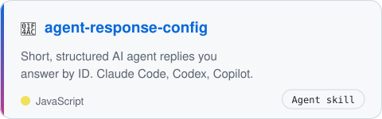
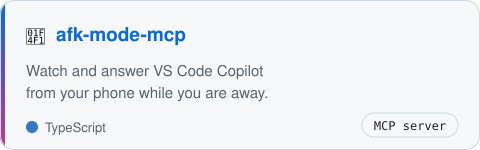
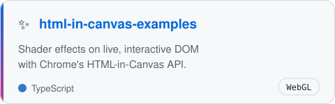
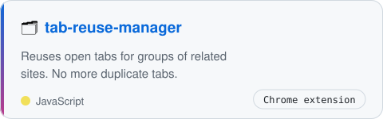
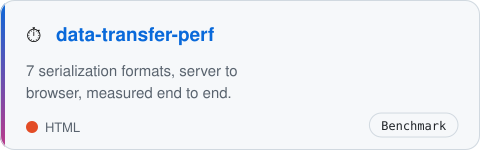
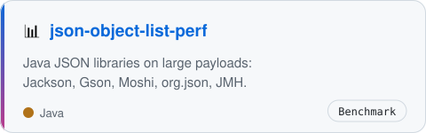

<picture><source media="(prefers-color-scheme: dark)" srcset="assets/header-dark.svg"></picture>

<a href="https://paulbennetjoshua.dev"><b>paulbennetjoshua.dev</b></a>

I build browser tools, developer tools and performance benchmarks. Lately: AI agent workflows, new Chrome APIs, and making data move faster from server to browser.

### 🧰 Things I made

<a href="https://github.com/paulbennet/agent-response-config"><picture><source media="(prefers-color-scheme: dark)" srcset="assets/agent-response-config-dark.svg"></picture></a>
<a href="https://github.com/paulbennet/afk-mode-mcp"><picture><source media="(prefers-color-scheme: dark)" srcset="assets/afk-mode-mcp-dark.svg"></picture></a>
 
<a href="https://github.com/paulbennet/html-in-canvas-examples"><picture><source media="(prefers-color-scheme: dark)" srcset="assets/html-in-canvas-examples-dark.svg"></picture></a>
<a href="https://github.com/paulbennet/tab-reuse-manager"><picture><source media="(prefers-color-scheme: dark)" srcset="assets/tab-reuse-manager-dark.svg"></picture></a>
 
<a href="https://github.com/paulbennet/server-webclient-data-transfer-perf"><picture><source media="(prefers-color-scheme: dark)" srcset="assets/server-webclient-data-transfer-perf-dark.svg"></picture></a>
<a href="https://github.com/paulbennet/json-object-list-perf"><picture><source media="(prefers-color-scheme: dark)" srcset="assets/json-object-list-perf-dark.svg"></picture></a>

### 🛠️ Stack

`JavaScript` `TypeScript` `Java` `Node.js` `WebGL` `Chrome extensions` `MCP` `WebSockets`

🎮 when the build runs · 🎹 when it passes

